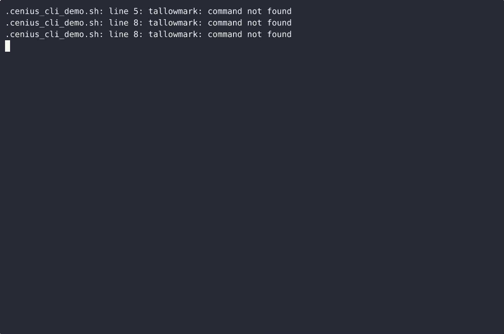
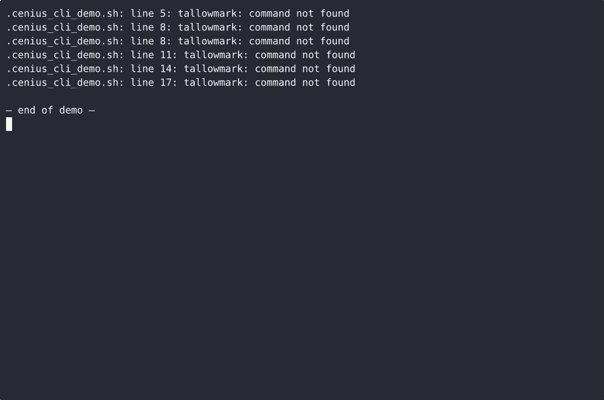

# Tallowmark — complete Full-stack app command-line tool example app

**Tallowmark** is Apache-2.0-licensed and fully open-source: a command-line tool written in Full-stack app that you can run, modify, and ship commercially without restrictions. Tallowmark is a single-file, standard-library-only Python command-line tool for a home candle maker: `tallowmark dip <batch>` counts wax dips per batch, `tallowmark note add|list` keeps free-text wax batch notes, and…. Grab Tallowmark from this repo and self-host it, or [remix it on cenius.ai](https://cenius.ai/marketplace/p/tallowmark?ref=gh&utm_campaign=tallowmark-webapp) — the platform grants full rebrand rights on every change.


[](LICENSE)  [](https://cenius.ai)

[](https://cenius.ai/marketplace/p/tallowmark?ref=gh&utm_campaign=tallowmark-webapp)

> **▶ [Open & edit in cenius.ai](https://cenius.ai/marketplace/p/tallowmark?ref=gh&utm_campaign=tallowmark-webapp)** — one click to an editable workspace: describe changes in plain English, get an instant preview, one-click deploy and host. Modifications made on the platform come with full rebrand & relicense rights.

_Local clone? See [Quick start](#quick-start) below. cenius.ai is the zero-setup path._

## Demo


📽 **[Demo video on cenius.ai](https://cenius.ai/marketplace/p/tallowmark?ref=gh&utm_campaign=tallowmark-webapp)** — the complete run-through · [MP4](.github/media/demo.mp4)

## Screenshots

 

## Architecture

Folder layout: `tests/`. `install.sh` provisions dependencies and seeds demo data so the app starts with something real to explore. Built in Full-stack app (22 files). Step-by-step setup guide: [`INSTALL.md`](INSTALL.md).

## Features

- Candle dip count tracker
- Wax batch notes
- Cure time countdown

## Quick start

```bash
./install.sh   # installs dependencies + seeds demo data
```

See [`INSTALL.md`](INSTALL.md) for full setup and usage instructions.

## Usage guide

Five walkthroughs, one per surface, all with real output. Set a store first if you
want to try them side by side:

```bash
export TALLOWMARK_FILE=/tmp/tallowmark-demo.json
```

### 1. Wax batches (`batch`)

Create batches. Identity is case-folded, so casing can never split a batch in two,
but the display name keeps the casing you typed first.

```console
$ tallowmark batch new Lavender
created batch: Lavender
$ tallowmark batch new Beeswax
created batch: Beeswax
$ tallowmark batch new lavender
batch already exists: lavender        # exit 1
$ tallowmark batch new "   "
batch name required                   # exit 1
$ tallowmark batch list
Lavender
Beeswax
```

Look one up in any casing:

```console
$ tallowmark batch show LaVeNdEr
Lavender
────────────────────────
created: 2026-10-18T19:14:52Z
dips: 2
cure: 2d 0h left
notes: 1
```

Empty store:

```console
$ tallowmark batch list
no batches yet
```

A batch that does not exist:

```console
$ tallowmark batch show Ghost
unknown batch: Ghost                  # exit 1
```

### 2. Dip counting (`dip`)

Every `dip add` records a timestamp and prints the running count.

```console
$ tallowmark dip add Lavender
Lavender: 1 dip
$ tallowmark dip add Lavender
Lavender: 2 dips
$ tallowmark dip list Lavender
[2026-10-18T19:14:53Z] dip 2
[2026-10-18T19:14:53Z] dip 1
```

`dip list` is newest-first; `dip add` on a batch with no dips yet is a normal add, and
`dip list` on a batch with no dips prints:

```console
$ tallowmark dip list Beeswax
no dips yet
```

_Full guide: [`USAGE.md`](USAGE.md)_

## FAQ

### What's the quickest way to self-host Tallowmark?

Everything you need ships in this repo: clone it, run `./install.sh` to install dependencies and seed demo data, then follow [`INSTALL.md`](INSTALL.md) to start it. No external services required.

### Can I remove the Tallowmark name and use my own?

Absolutely. [Open it on cenius.ai](https://cenius.ai/marketplace/p/tallowmark?ref=gh&utm_campaign=tallowmark-webapp) and remix it there — platform modifications come with full rebrand and relicense rights over your derivative, so the result is entirely yours.

### What is Tallowmark built with?

Full-stack app end-to-end. Every file you need to run the app is here in this repository — code, configuration, seed data. Highlights include cure time countdown.

### How can I customize Tallowmark without editing code?

[cenius.ai](https://cenius.ai/marketplace/p/tallowmark?ref=gh&utm_campaign=tallowmark-webapp) handles the implementation. Tell it what you want in everyday words, pick up the updated build. No coding needed.

### Can I build a business on Tallowmark?

The code is under the Apache-2.0 license, which allows commercial use without restriction. You can build, sell, and deploy it freely. Full text: [LICENSE](LICENSE).

## License & rebranding

Released under the [Apache License 2.0](LICENSE) (© 2026 Cenius AI) — free for personal and commercial use. The Cenius name/logo are trademarks (see NOTICE).

**Need a customized version?** [Remix this app on cenius.ai](https://cenius.ai/marketplace/p/tallowmark?ref=gh&utm_campaign=tallowmark-webapp) — modifications made on the platform come with **full rebrand & relicense rights** over your derivative.

## Built with cenius.ai

This entire application — code, design, seeded demo data — was generated on **[cenius.ai](https://cenius.ai)** from a plain-English description.

- 🚀 [Build your own app on cenius.ai](https://cenius.ai)
- 🎛️ [Remix Tallowmark on the marketplace](https://cenius.ai/marketplace/p/tallowmark?ref=gh&utm_campaign=tallowmark-webapp) — open it in a workspace, prompt for changes, and ship your own version.

More open-source apps: [the Cenius-ai catalog](https://github.com/Cenius-ai) · [showcase index](https://github.com/Cenius-ai/showcase)
